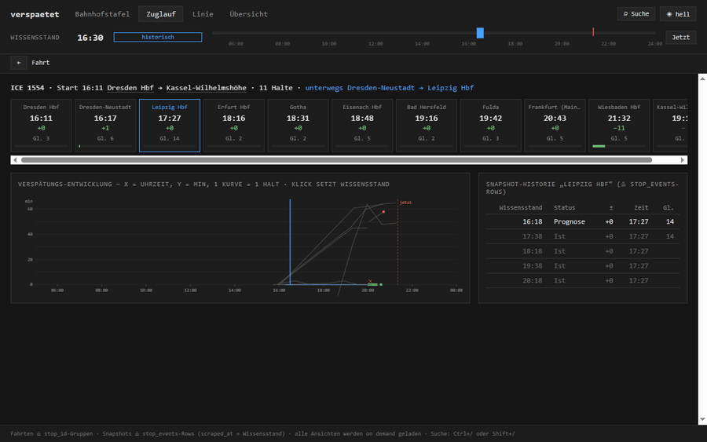
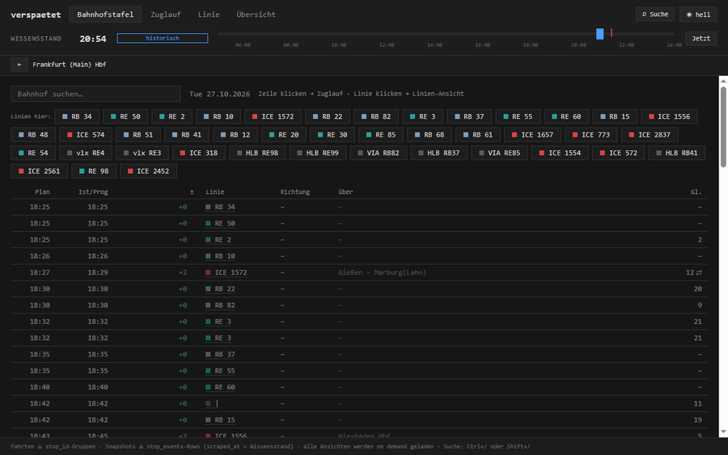
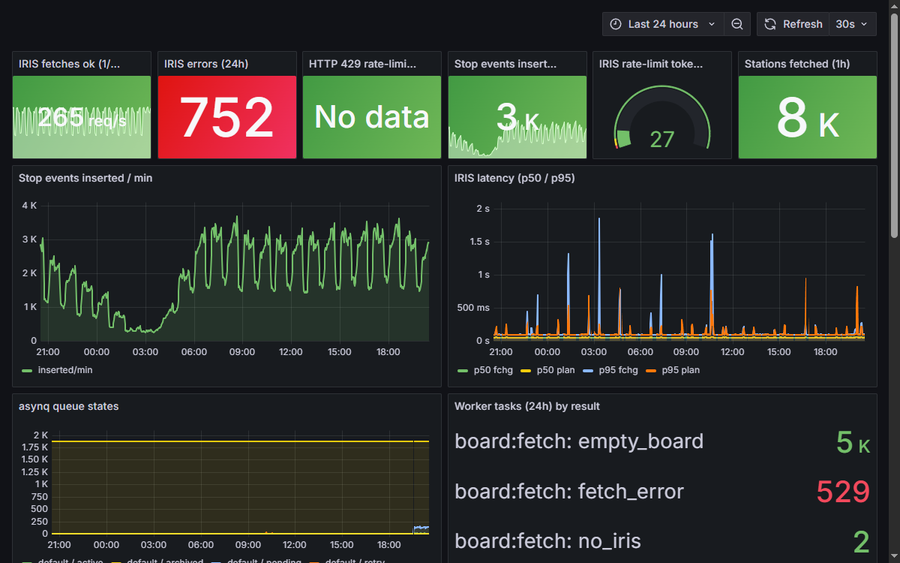

# verspaetet

Experimental project to aggregate a dataset of Deutsche Bahn delays at train stations.

verspaetet (German for "delayed") collects departure and arrival board data for all ~5,400 German IRIS stations via the official DB Timetables API, persists every snapshot to Postgres, and publishes the result as a monthly delay-evolution dataset on HuggingFace. A built-in data UI lets you scrub through time and watch how delays evolved.





## Ops monitoring

Collection is watched by a self-hosted Grafana stack:



## The dataset

Monthly Parquet chunks of delay-evolution snapshots for all German IRIS stations.

- **What:** per train stop: planned/actual time, delay, platform (planned/actual), cancellation, line category, public line label (IRIS `l` attribute, e.g. S12 — `train_number` is the operational trip number, 5-digit for S-Bahn), train number, operator, route path. Multiple snapshots per train stop = how the communicated delay evolved over time (the unique value of this dataset: endpoint-only "final delay" data exists elsewhere; this records the whole curve).
- **Coverage:** all ~5,400 IRIS-active stations, one snapshot every 40 minutes (same cadence for every station), both directions from one request per station.
- **Gaps:** known downtime is documented per chunk in `manifest.json` (`coverage.downtimes`) and the chunk README; `coverage.missing_days` lists operating days without any data.
- **Format:** Parquet (zstd). On HuggingFace: one folder per operating month at `<YYYY-MM>/` containing `stop_events_<YYYY-MM>.parquet`, `stations.parquet` (full registry, refreshed each export), `manifest.json` (SHA256, coverage, schema version) and a per-month `README.md` dataset card. A root `README.md` is regenerated on each export and indexes all chunks. Local copies mirror the same layout under `/exports/<YYYY-MM>/`.
- **License:** CC BY 4.0 (attribution required, see below).
- **Where:** [huggingface.co/datasets/LinusRichter404/verspaetet](https://huggingface.co/datasets/LinusRichter404/verspaetet) - first chunk (2026-09) publishes 2026-10-04, one chunk on the 4th of each month (previous operating month, +3 days finality lag).

> **Note:** This is a POC built entirely with agentic code. The quality is rough.
>
> **Rate limits:** Building a gapless dataset (all ~5,400 stations at a consistent, fine-grained cadence) requires a rate limit beyond the free tier (60 req/min for IRIS). Such an increase must be requested from the API provider (developers.deutschebahn.com / IRIS-TTS.API@deutschebahn.com).

## Setup

1. Register at [developers.deutschebahn.com](https://developers.deutschebahn.com) and subscribe to the **free** plans of "Timetables" and "Station Data"
2. Configure:

```bash
cp .env.example .env   # set POSTGRES_PASSWORD, IRIS_CLIENT_ID, IRIS_API_KEY
```

3. Run:

```bash
docker compose up -d
```

UIs:
- Data UI: `http://localhost:8080`
- Ops dashboard (Grafana): `http://localhost:8082` (see [monitoring/](monitoring/))

## Architecture

```
scheduler ──minute tick──▶ asynq (Redis) ──▶ worker ──▶ IRIS Timetables API
                                │                │       /fchg (changes, ~4 h window)
                                │                │       /plan (planned hour slice, cached)
                                │                ▼
                                │           Postgres (stop_events — append-only snapshots)
                                ▼
                             worker ──monthly──▶ Parquet chunk ──▶ HuggingFace
                                                  │
                                                  └─▶ API (:8080) ──▶ Data UI (web/dist)
```

Plain asynq tasks only — no workflow engine. The IRIS client is pinned to HTTP/1.1 (the API gateway resets HTTP/2 streams sporadically; see `activities/iris.go`). Fetches are staggered per station (`fetch_offset = hash(slug) % CADENCE_MINUTES`), both directions arrive in one document per request, and asynq retries absorb transient upstream errors — measured collection gaps below the 40-minute cadence heal completely (the ~4 h fchg window re-delivers everything a late scrape missed).

## Data model

```
stations        EVA-keyed station registry (StaDa: name, category, lat/lon)
scrape_runs     provenance: one row per (station, direction, scrape)
stop_events     the dataset: snapshots per (station, stop_id) — planned/actual
                time, platform (planned/actual), route path, cancellation,
                train category/number/operator; multiple rows per stop =
                delay evolution
pending_stations discovery: unresolved route-path names
```

Views: `delays` (NULL-preserving delay_seconds), `platform_changes`.

## License

The code of this repository is licensed under **MIT**.

The **collected dataset** (delay snapshots of Deutsche Bahn trains) is derived from data provided by the **Deutsche Bahn Timetables API (IRIS)** and the **DB StaDa API**, which Deutsche Bahn publishes under the [Creative Commons Attribution 4.0 International (CC BY 4.0)](https://creativecommons.org/licenses/by/4.0/) license. Any published dataset will therefore be released under CC BY 4.0 with attribution: