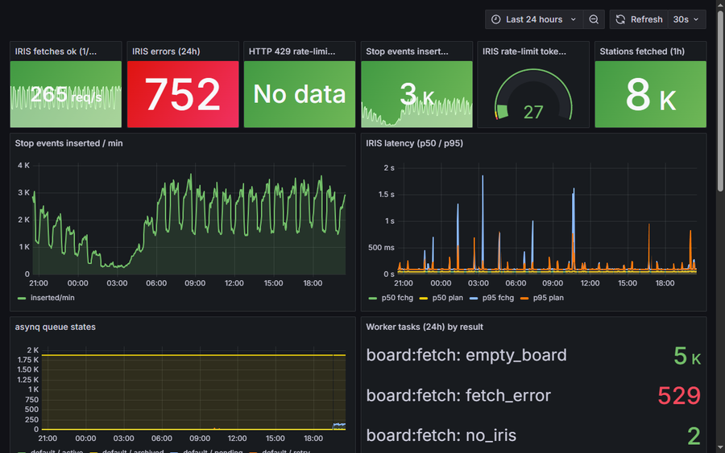

# verspaetet


Experimental project to aggregate a dataset of Deutsche Bahn delays at train stations.

verspaetet (German for "delayed") collects departure and arrival board data for all ~5,400 German IRIS stations via the official DB Timetables API, stores every change of a train's forecast in Postgres, and publishes the result as a monthly delay-evolution dataset on HuggingFace.

To browse and analyse the published data, see [verspaetet-explorer](https://github.com/LinusRichter/verspaetet-explorer).

## Ops monitoring

Collection is watched by a self-hosted Grafana stack:



## The dataset

Monthly Parquet chunks of delay-evolution snapshots for all German IRIS stations.

- **What:** per train stop: planned/actual time, delay, platform (planned/actual), cancellation, line category, public line label (IRIS `l` attribute, e.g. S12; `train_number` is the operational trip number, 5-digit for S-Bahn), train number, operator, route path. Multiple snapshots per train stop = how the communicated delay evolved over time (the unique value of this dataset: endpoint-only "final delay" data exists elsewhere; this records the whole curve).
- **Coverage:** all ~5,400 IRIS-active stations, one snapshot every 40 minutes (same cadence for every station), both directions from one request per station.
- **Gaps:** known downtime is documented per chunk in `manifest.json` (`coverage.downtimes`) and the chunk README; `coverage.missing_days` lists operating days without any data.
- **Snapshots are change-only:** a new row is written only when actual time, platform, destination, route or cancellation changed. `scrape_runs.parquet` (from schema v0.3) is the fetch log: one row per successful board fetch per station and direction, so "unchanged" can be told apart from "not observed".
- **Format:** Parquet (zstd). On HuggingFace: one folder per operating month at `<YYYY-MM>/` containing `stop_events.parquet`, `scrape_runs.parquet`, `manifest.json` (SHA256, coverage, schema version) and a per-month `README.md` dataset card. `stations.parquet` (full registry, refreshed each export) and the root `README.md` (index of all chunks, column schema) sit at the repo root and are regenerated on each export. Local copies live under `/exports/<YYYY-MM>/`, with the stop events named `stop_events_<YYYY-MM>.parquet`.
- **License:** CC BY 4.0 (attribution required, see below).
- **Where:** [huggingface.co/datasets/LinusRichter404/verspaetet](https://huggingface.co/datasets/LinusRichter404/verspaetet). One chunk per operating month, published from the 4th of the following month (3-day finality lag); a failed export is retried daily. First chunk: 2026-09.

> **Status:** Experimental. The code was written largely with AI coding agents. Collection has been running since 2026-09-21.
>
> **Rate limits:** Building this dataset (all ~5,400 stations at a consistent cadence) requires a rate limit beyond the free tier (60 req/min for IRIS). Such an increase must be requested from the API provider (developers.deutschebahn.com / IRIS-TTS.API@deutschebahn.com).

## Setup

1. Register at [developers.deutschebahn.com](https://developers.deutschebahn.com) and subscribe to the **free** plans of "Timetables" and "Station Data"
2. Configure:

```bash
cp .env.example .env   # set POSTGRES_PASSWORD, IRIS_CLIENT_ID, IRIS_API_KEY
```

3. Run:

```bash
docker compose up -d
```

Ops dashboard (Grafana): `http://localhost:8082`. The API on `:8080` only serves `/api/health` and `/metrics`.

Optional settings in `.env` (defaults in brackets): `CADENCE_MINUTES` [40], `IRIS_RATE_LIMIT` [60 req/min], `HF_TOKEN`/`HF_REPO` (upload to HuggingFace; without them chunks stay in `/exports`), `EXPORT_TIMEOUT` [12h, one export attempt including the upload], `EXPORT_MIN_FREE_GB` [25, an export does not start with less free disk].

## Architecture

```
scheduler ──minute tick──▶ asynq (Redis) ──▶ worker ──▶ IRIS Timetables API
                                │                │       /fchg (changes, ~4 h window)
                                │                │       /plan (planned hour slice, cached)
                                │                ▼
                                │           Postgres (stop_events: change-only snapshots)
                                ▼
                             worker ──monthly──▶ Parquet chunk ──▶ HuggingFace

API (:8080): /api/health + /metrics ──▶ VictoriaMetrics ──▶ Grafana (:8082)
```

## Data lifecycle

Postgres only holds recent data. Each operating month goes through four steps, tracked per month in the `export_runs` table:

1. **Export:** from the 4th of the following month, 04:00 UTC, the scheduler enqueues the export. It checks every hour, so a restart cannot skip a month, and retries a failed export once a day. Files go to `/exports/<YYYY-MM>/`.
2. **Upload:** with `HF_TOKEN`/`HF_REPO` set, the chunk is uploaded to HuggingFace and verified against the repo (file checksums and the published manifest).
3. **Off-site backup:** your own backup job copies the chunk and a database dump somewhere safe and records it with `seeder --mark-offsite YYYY-MM`.
4. **Prune:** `seeder --prune-month YYYY-MM` deletes the month's `stop_events` and the already published fetch-log rows. It refuses unless the month is uploaded and re-verified on HuggingFace, marked off-site, and the number of rows in Postgres equals the exported chunk exactly. `--dry-run` shows what it would delete.

The seeder runs inside the worker container, e.g. `docker compose exec worker /app/bin/seeder --status`. Months exported before `export_runs` existed are registered with `--adopt-month YYYY-MM`. Without HuggingFace credentials or an off-site mark nothing is ever deleted.

## Data model

```
stations        EVA-keyed station registry (StaDa: name, category, lat/lon;
                no_iris = skipped, has_data = delivered events at least once)
scrape_runs     fetch log: one row per successful (station, direction, scrape)
stop_events     the dataset: change-only snapshots per (station, stop_id):
                planned/actual time, platform (planned/actual), route path,
                cancellation, train category/number/operator; multiple rows
                per stop = delay evolution
pending_stations discovery: unresolved route-path names
export_runs     per-month state: exported, uploaded, off-site, pruned
```

Views: `delays` (NULL-preserving delay_seconds), `platform_changes`.

## License

The code of this repository is licensed under **MIT**.

The **collected dataset** (delay snapshots of Deutsche Bahn trains) is derived from data provided by the **Deutsche Bahn Timetables API (IRIS)** and the **DB StaDa API**, which Deutsche Bahn publishes under the [Creative Commons Attribution 4.0 International (CC BY 4.0)](https://creativecommons.org/licenses/by/4.0/) license. Any published dataset will therefore be released under CC BY 4.0 with attribution:

> Data: Deutsche Bahn (Timetables API & StaDa API), license CC BY 4.0. Dataset: verspaetet, [huggingface.co/datasets/LinusRichter404/verspaetet](https://huggingface.co/datasets/LinusRichter404/verspaetet)

When reusing the dataset, keep this attribution and link the license.